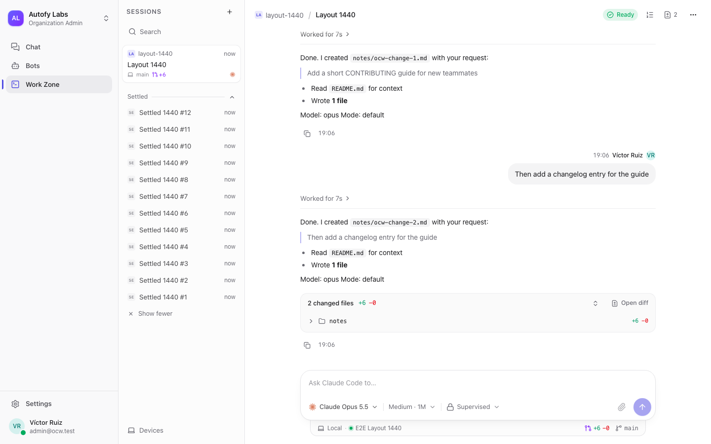

# Open Collaborative AI Workspace

**The open-source, self-hosted workspace where people and AI agents work together.**

[](LICENSE)


Most companies use AI one person at a time: everyone has their own ChatGPT, Claude, Codex, prompts and tools, and
none of it is shared, governed or audited. This project turns that into shared company infrastructure, and the
coding agents keep running on people's own machines.



- **Chats.** Slack-style channels, threads and DMs where people and bots are peers. AI chats are multiplayer:
  share one with a colleague and the model knows who is speaking.
- **Work Zone.** Claude Code and Codex sessions run on a developer's machine or a team server, but the platform owns
  them. Teammates can watch, prompt, queue, steer and approve from the browser.
- **Agents.** Persistent server-side bots (on OpenClaw) with their own identity,
  memory, approvals, sandboxes, automations and Agent Cards. Bots can consult each other within admin-set rules.
- **One control plane.** Organization, departments, teams and projects, intersected permissions (deny wins), model
  providers, connectors, a keychain, devices and a full audit log.

Everything runs with `docker compose` on your own server. No essential feature depends on a managed cloud.

## Contents

- [Status](#status)
- [Install it on a server (tutorial)](#install-it-on-a-server)
- [Try it on your laptop](#try-it-on-your-laptop)
- [Known limitations](#known-limitations)
- [How it is built](#how-it-is-built)
- [Contributing, security and license](#contributing)

## Status

**MVP 1 is ready for team testing.** It includes:

- **Chat:** channels, threads, DMs, attachments, search and notifications.
- **AI chats:** multiplayer, with org keys or each member's own ChatGPT plan.
- **Bots:** OpenClaw bots, personas, Agent Cards, memory, per-tool approvals, sandboxes and a browser, automations and
  bot-to-bot consultations.
- **Work Zone:** the Work Zone with the desktop app (macOS, Windows, Linux) or a headless Linux/macOS server.
- **Bots in the Work Zone:** a bot starts and drives Work Zone sessions itself through its profile (device or server,
  projects, runtime, model, permissions). Full access needs the organization policy, the device's opt-in for that bot
  and the profile. A live card in the conversation opens the session, and the session links back.
- **Automations:** schedules as often as every 5 minutes. An automation can open one conversation per new item it
  finds (a thread in a channel or a card on a board), never the same item twice, capped per run and per day. The bot
  works each item in its own turn, with its Work Zone profile, and moves the card it opened.
- **Team mentions:** people and bots mention a team or department with `@team`. Its members who can read the
  conversation get a notification. An automation can name the people or teams its bot mentions when it finishes or
  needs help.
- **Self-hosting:** a self-hosted release with HTTPS, backups, upgrades, OpenBao and observability.

[`docs/STATUS.md`](docs/STATUS.md) lists what is built, and the roadmap continues in
[`docs/prd/PRD.md`](docs/prd/PRD.md) (MVP 2–7). Expect rough edges: report them as
[issues](../../issues).

## Install it on a server

This takes about 20 minutes, most of it the first image build. At the end your team signs in at
`https://ocw.your-company.com`.

### 1. Get a server and a name

| What | Recommended |
| --- | --- |
| Server | Ubuntu 24.04 or Debian 12 (x86_64 or arm64) with root or sudo |
| Size | 4 vCPU, 8 GB RAM, 40 GB disk (the minimum is 2 vCPU, 4 GB RAM, 20 GB disk) |
| DNS | An `A` (or `AAAA`) record such as `ocw.your-company.com` pointing at the server |
| Network | Inbound TCP 80 and 443 open (Let's Encrypt and HTTPS). Outbound HTTPS to GitHub, Docker Hub, `ghcr.io`, the npm registry and your model providers |

No domain yet? Pass the server's IPv4 address instead. You get HTTPS from Caddy's own certificate authority, which
every browser warns about until its root certificate is trusted (the installer prints how).

### 2. Run the installer

```bash
curl -fsSL https://raw.githubusercontent.com/VictorMinemu/open-collaborative-ai-workspace/main/scripts/install.sh \
  | sudo bash -s -- --domain ocw.your-company.com
```

To read the script before running it, download it first:

```bash
curl -fsSLo install.sh https://raw.githubusercontent.com/VictorMinemu/open-collaborative-ai-workspace/main/scripts/install.sh
less install.sh
sudo bash install.sh --domain ocw.your-company.com
```

From a checkout, `sudo ./scripts/install.sh --domain …` installs that checkout in place.

The [installer](scripts/install.sh) does five things:

1. Installs git, Docker Engine with Compose (from Docker's apt repository) and Node 24 (checksum-verified from
   nodejs.org), if they are missing.
2. Clones the project into `/opt/ocw`.
3. Generates every secret into `/opt/ocw/.env` (mode 0600, never printed).
4. Puts web, API, WebSockets and attachments behind Caddy on one HTTPS origin.
5. Builds and starts the stack.

Re-running it is safe. It resumes a failed build and never overwrites `.env` or rotates a secret. Run
`install.sh --help` for the options (`--dir`, `--ref`, `--tls internal`, `--dry-run`).

### 3. Create your organization

```bash
sudo grep '^OCW_SETUP_TOKEN=' /opt/ocw/.env
```

Open `https://ocw.your-company.com/setup` and paste that one-time token. Then name the organization and create the
first admin account; the password needs at least 12 characters.

### 4. Connect a model

Go to **Settings › Models** and add at least one provider:

| Provider | What you need |
| --- | --- |
| OpenAI, Anthropic or OpenRouter | An API key (metered: the organization pays) |
| OpenAI-compatible | A base URL, plus a key and model ids (vLLM, LiteLLM, Ollama…). The bots run inside a container, so the URL must be reachable from it, not `localhost` |
| ChatGPT subscription | A sign-in, no key. Bots only |

Each member can also use their own ChatGPT plan for AI chats: **Settings › AI chat › Continue with ChatGPT**. Usage
then counts against their plan, never the organization's. Claude is available through an org API key only.

### 5. Invite your team

Go to **Settings › Members**, enter an email, pick a role and press **Invite**. You get a link to send however you
like; no mail server is needed, and links expire after 7 days. There is no public sign-up. Password-reset emails need
SMTP (`OCW_SMTP_URL`, `OCW_MAIL_FROM` in `.env`). Without it, an admin creates a reset link from the member's row.

### 6. What to try first

- **Channels and threads.** Post in `#general`, reply in a thread, mention someone with `@`, attach a file and search
  it.
- **A bot.**
  1. Open **Bots › New bot** and pick a preset such as Researcher or Support.
  2. Choose a model and press **Create bot**.
  3. When it shows **Ready**, use **Add to channel** and write `@its-handle what should we build first?`. It answers
     in the thread.
- **A shared AI chat.** Start one under **AI Chats**, then share it with a colleague. You both talk to the same
  model, and it knows who is who.
- **A personal bot.** **Create your personal bot** in the sidebar gives each member their own private bot.
- **Bots helping bots.** In **Settings › Bot policy**, turn on *Bots may consult each other*. A bot can then ask
  another one in the thread, and every hop stays visible and audited.

### 7. Connect the Work Zone

The Work Zone runs Claude Code or Codex on a machine you choose, under your own subscription:

- **A teammate's computer**, with the desktop app from the [latest release](../../releases/latest). The builds are
  not signed yet, so the first launch needs one extra step:
  - **Mac** (Apple silicon): open `OCW-<version>-macos-arm64.dmg` and drag OCW to Applications. Open it once, then
    go to **System Settings › Privacy & Security** and choose **Open Anyway** (or run
    `xattr -dr com.apple.quarantine /Applications/OCW.app`).
  - **Windows** (x64): run `OCW-<version>-windows-x64-setup.exe`. If SmartScreen stops it, choose **More info ›
    Run anyway**. It installs for the current user, without admin rights.
  - **Linux** (x64): on Ubuntu or Debian, `sudo apt install ./OCW-<version>-linux-amd64.deb`. Elsewhere,
    `chmod +x OCW-<version>-linux-x86_64.AppImage` and run it. The app keeps the device token in the desktop
    keyring (GNOME Keyring or KWallet), which must be available.

  Then enter your workspace URL and pair it under **Settings › Devices › Add device › Desktop app**.
- **A shared Linux or macOS server** with no desktop app:
  1. Under **Settings › Devices › Add a device › Server**, copy the one-line command (`curl … /api/v1/runtime/install.sh | sh`).
  2. Run it there as a non-root user.
  3. Run `ocw-runtime setup --project ~/src/your-repo --service user`.
  4. Approve the pairing link it prints.

  Then share the server with people or teams. Details: [`docs/SERVER.md`](docs/SERVER.md).

### 8. Operate it

Run these from `/opt/ocw`:

| Task | Command |
| --- | --- |
| Status and logs | `docker compose ps`, then `docker compose logs -f api` |
| Back up (database, files, bot state) | `node scripts/ocw.mjs backup` → `backups/<time>/` |
| Upgrade to the newest release | `sudo node scripts/ocw.mjs upgrade` (backup, new release, new keys, rebuild; `--check` only looks) |
| Monitoring (Grafana, Prometheus, Loki, Tempo) | `node scripts/ocw.mjs enable observability` |
| Secrets in OpenBao | `node scripts/ocw.mjs enable vault` |
| Stop, keeping the data | `docker compose down` |

Keep `.env`, `secrets/` and `backups/` private, and back up `.env` separately: a backup never contains it. The full
guide, including restore, a second instance on one host and troubleshooting, is [`docs/INSTALL.md`](docs/INSTALL.md).

## Try it on your laptop

You need Docker Desktop (or Docker Engine), git, Node 24 and corepack:

```bash
git clone https://github.com/VictorMinemu/open-collaborative-ai-workspace.git ocw && cd ocw
corepack enable
pnpm ocw setup                         # writes .env with generated secrets
docker compose up -d --build --wait    # first build: 10-20 minutes
grep '^OCW_SETUP_TOKEN=' .env          # then open http://localhost:3000/setup
```

This setup serves only the machine it runs on. To give a team access, use the server install above.

## Known limitations

MVP 1 is for testing with your team, not yet for production-critical work:

- **Desktop app:** builds for macOS on Apple silicon, Windows x64 and Linux x64, none of them signed yet. Signed
  builds are MVP 2 (Phase 9).
- **Attachments and bots:** bots read text, code, CSV, JSON, PDFs with a text layer and images (image-capable models);
  no OCR for scanned PDFs, no audio or video; Office files only through a bot's sandbox; bots on a ChatGPT plan cannot
  see images yet.
- **Claude:** works through an org API key only. Some ChatGPT Business or Enterprise seats cannot sign in with their
  plan.
- **HTTPS required:** a plain-HTTP remote address breaks attachments, sign-ins to connectors and the runtime
  installer. The installer always sets up HTTPS.
- **AI chats:** web search on org models needs the optional `search` profile. Company knowledge, MCP and skills in AI
  chats are not available yet.
- **Headless Work Zone server:** no Windows service and no container image.
- **Bots in the Work Zone:** bots never approve runtime requests; people do. A `people` audience is a snapshot of the
  conversation when the session starts.
- **Automation fan-out:** only from schedules (webhooks and mail keep one item per event). An item past the bot's
  Work Zone limit ("Sessions at once") waits and starts again when one of the bot's sessions ends, and one refused at
  the bot's daily limit starts again the next day, each at most 5 times; a session that stays open (idle) still holds
  its place, so the bot should stop sessions it is done with. Fan-out needs the matching cell image. A team's
  `@handle` cannot be edited yet.
- **Not yet proven against real services by the maintainers:**
  - an install on a clean machine;
  - real mailbox and ERP automations, and fan-out from a real orders MCP;
  - Full-access mode;
  - a bot running a real session on a server.

  They are listed as owner checks in [`docs/DEMO.md`](docs/DEMO.md).

## How it is built

The web app is Next.js, and the desktop app is Electron with a local runtime daemon. Both talk to a Fastify modular
monolith that holds sessions, permissions and audit:

- **Data:** PostgreSQL with row-level security on every tenant table. Redis carries realtime events, and
  S3-compatible storage (Garage) holds files.
- **Bots:** they run in an OpenClaw container and reach the platform only through the Agent Channel API.
- **Coding sessions:** they run where the code is, and only repo-relative paths ever leave the device.

| Read | For |
| --- | --- |
| [`docs/prd/PRD.md`](docs/prd/PRD.md) | The product requirements (authoritative) |
| [`docs/adr/`](docs/adr/) | Architecture decisions and why |
| [`docs/STATUS.md`](docs/STATUS.md) | What is built so far |
| [`docs/INSTALL.md`](docs/INSTALL.md), [`docs/self-hosting/`](docs/self-hosting/) | Install and operations |
| [`AGENTS.md`](AGENTS.md) | Rules for AI coding agents (and a fast tour for humans) |

## Contributing

Contributions are welcome. Read [`CONTRIBUTING.md`](CONTRIBUTING.md) for the development setup, tests and
conventions. Everyone who takes part follows the [Code of Conduct](CODE_OF_CONDUCT.md).

**Security:** please do not open public issues for vulnerabilities. See [`SECURITY.md`](SECURITY.md).

**License:**

- The server, control plane, web, desktop and mobile apps are [AGPL-3.0](LICENSE).
- The protocol, SDKs and plugins will be published under Apache-2.0 in their own packages.
- The project name and logo are not covered by the code license.
